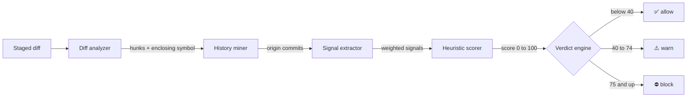
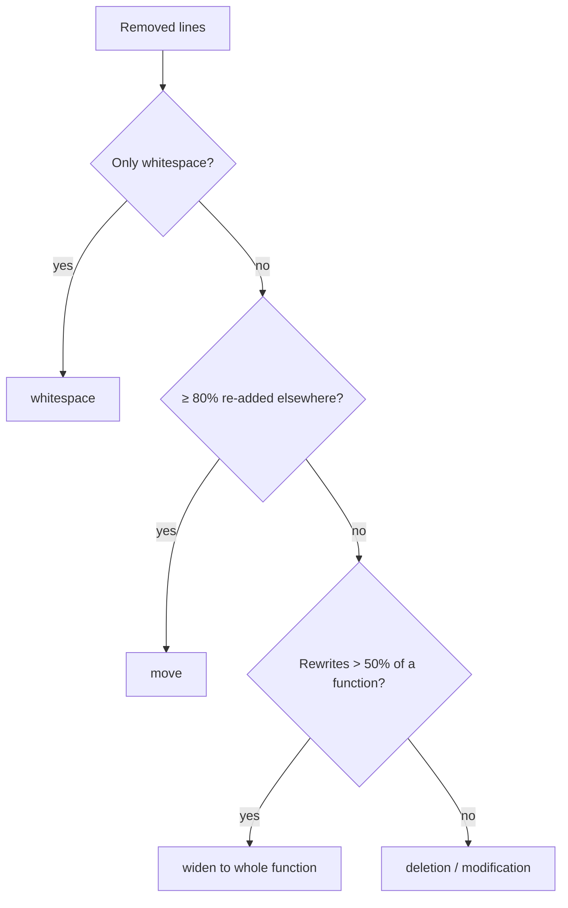

<div align="center">

# 🧱 Chesterton's Fence Agent

**Know why code exists before you delete it.**

A pre-commit check that reads your git history and tells you when a change removes code<br>
that was put there on purpose: after a bug, an outage, a security issue, or an earlier mistaken removal.


</div>

---

> *"Do not remove a fence until you know why it was put up in the first place."*
> &nbsp;&nbsp;— paraphrasing G. K. Chesterton, *The Thing* (1929)

## The problem

Every codebase has lines that look pointless and aren't:

```python
def charge(order):
    receipt = gateway.submit(order.total)
    if receipt is None:                      # ← looks redundant
        raise GatewayError("empty response") # ← "simplify" it away?
    ledger.record(receipt)
```

Why the check is there doesn't show in the code. It's recorded somewhere else: a commit titled
*"Fix duplicate charges during gateway outage (INC-412)"*, a pull request, or an incident review.
People who are refactoring, and AI coding agents especially, delete lines like this because nothing
nearby says why they exist.

Chesterton's Fence Agent looks that reason up for you before the commit goes through.

```console
$ git commit -m "Simplify charge()"

chesterton: 1 block, 1 warn, 0 allow

BLOCK  81.5  billing.py:21-22  charge  [deletion]
  Added for an incident or security issue: b7eec8b on 2024-01-15, "Fix duplicate charges during gateway outage (INC-412)".
  commit:b7eec8b74cad  2024-01-15  Fix duplicate charges during gateway outage (INC-412)  (incident_or_security, fix_surgical)

WARN  55  retry.py:21-22  charge  [deletion]
  Added by a small bug fix: 1c8d52a on 2024-01-15, "Fix crash when gateway returns an empty body".
  commit:1c8d52a4875c  2024-01-15  Fix crash when gateway returns an empty body  (fix_surgical)
```

Each verdict cites the commit that supports it. The tool never claims a reason it can't point to.

## How it works



### 1. Diff analyzer: what's actually being removed?

The diff is cut into **hunks**, and each one is classified before any history is read. Moved or
reformatted code shouldn't raise an alarm.

| Kind | Example | Effect on risk |
|---|---|---|
| **deletion** | lines removed, nothing added | scored normally |
| **modification** | lines replaced with different lines | scored normally |
| **move** | ≥ 80% of the removed lines reappear elsewhere in the change, including in a new file | × 0.1 |
| **whitespace** | only spacing changed (strings and Python indentation are respected) | × 0 |
| **rename** | file renamed with no content change | not scored |

[tree-sitter](https://tree-sitter.github.io/) then maps every hunk to the **function or class** it
lives in. When more than half of a function changes, the whole function is treated as removed logic,
so a check that survived a rewrite unchanged is still examined.



### 2. History miner: where did these lines come from?

For each hunk, `git blame -w -M -C -C` runs against the **parent** revision. That finds the commit
that wrote each removed line, even if the code was later re-indented or moved between files. The
tool then reads those commits' messages, sizes and authors, and checks for reverts.

### 3. Signals: is there a documented reason?

| Signal | Fires when the origin commit… | Weight |
|---|---|:---:|
| 🔁 **Revert of a removal** | is a `git revert` that restored these exact lines after someone deleted them | **80** |
| 🚨 **Incident or security** | mentions an outage, postmortem, `SEV2`, `INC-123`, `CVE-…`, XSS, injection… | **65** |
| 🩹 **Surgical bug fix** | says *fix / bug / regression / workaround* and changed ≤ 10 lines in total | **55** |
| ⏱️ **Concurrency or compat** | mentions a race, deadlock, timeout, retry, legacy clients, IE11… | **40** |
| 🏛️ **Long-lived, many hands** | is over 2 years old, and 3+ people have edited these lines | **15** |

Some messages don't count. A "fix typo" or "fix lint" commit isn't a reason for code to exist, and
sign-off lines are skipped so a reviewer named *Patch* can't trigger the fix keyword.

### 4. Scoring: combining the evidence

The strongest signal counts in full. The others add diminishing credit, and each kind of signal
counts once:

$$\text{score} = \min\Big(100,\; w_{\max} + 0.3 \times \sum w_{\text{others}}\Big) \times \text{modifiers}$$

**Worked example.** A commit called *"Fix duplicate charges during gateway outage (INC-412)"* that
changed 4 lines:

```
incident_or_security   65   ← strongest, counts fully
fix_surgical           55   × 0.3 = 16.5
                       ─────────────
score                  81.5  →  ⛔ block (≥ 75)
```

If the same code had only been **moved** to another file, the score would be 81.5 × 0.1 = 8.2,
which is ✅ allow. If it came from a repo's **initial bulk import**, it would be halved.

## Tried on real repositories

The tool replayed the last ~150 commits of two popular open-source projects:

| Repository | Commits | Errors | p50 | p95 | Blocks |
|---|:---:|:---:|:---:|:---:|:---:|
| pallets/flask | 132 | 0 | 0.17 s | 0.48 s | 1 |
| expressjs/express | 147 | 0 | 0.15 s | 0.29 s | 3 |

One true positive from Express: the commit `Revert "sec: security patch for CVE-2024-51999"` was
flagged in `parseExtendedQueryString`, and the finding cited the original CVE patch.

Known noise, which later milestones address:
- Dependency bumps that replace one CVE-fix version with a newer one look like removing a security fix. The LLM step (M3) is meant to judge whether the replacement keeps the fix.
- Squash-merged commits with long bullet lists can pass one bullet's keyword on to every line they touched.

## Install

```sh
git clone https://github.com/yajushivudatha/fence-agent.git
cd fence-agent
python3 -m venv .venv
.venv/bin/pip install -e '.[dev]'
```

All grammars ship pre-compiled, so the tool never contacts the network.

## Usage

```sh
chesterton check                       # staged changes vs HEAD (the default)
chesterton check --base main           # this branch vs its merge base with main
chesterton check --range A..B          # a commit range (A...B uses the merge base)
chesterton check --format json         # machine-readable report
chesterton check --mode strict         # fail on warnings too
```

### Modes and exit codes

| Mode | Fails the commit on | | Exit code | Meaning |
|---|---|---|:---:|---|
| `advisory` | nothing | | `0` | nothing blocks the change |
| `standard` | ⛔ block | | `1` | at least one block |
| `strict` | ⛔ block or ⚠️ warn | | `2` | a warning, in strict mode |
| | | | `3` | tool error, only with `--fail-closed` |

By default, tool errors exit `0`, so a broken tool never stops anyone from committing.

### Use it as a git hook today

```sh
printf '#!/bin/sh\nexec .venv/bin/chesterton check --staged\n' > .git/hooks/pre-commit
chmod +x .git/hooks/pre-commit
```

### What's skipped

Generated code, vendored code, `node_modules`, migrations, lockfiles, minified bundles, protobuf
output, and prose (`*.md`, `*.rst`, `docs/`). Hunks over 500 lines are skipped too, and the report
says so.

## Supported languages

Symbol mapping covers **Python, JavaScript, TypeScript/TSX, Go, Java, Rust, C, and C++**. Other files
still get line-level history analysis. They just don't get function names or rewrite detection.

## Roadmap


The planned **MCP server** lets AI coding agents call `check_removal` before they delete code, and
stop to ask a human whenever the verdict is ⛔ block.

## Project layout

```
chesterton/
├── cli.py               command line (typer)
├── pipeline.py          diff → blame → score → report
├── diff/
│   ├── analyzer.py      parse git diff, classify hunks, widen rewrites
│   ├── moves.py         detect relocated code
│   └── symbols.py       tree-sitter symbol mapping
├── history/
│   ├── blame.py         origin commits per line range
│   ├── log.py           commit metadata, revert contents, authors
│   └── signals.py       keyword classes, refs, revert markers
├── scoring/             weights and the heuristic score
├── verdict/engine.py    thresholds, modes, exit codes
└── report/text.py       terminal output
tests/
├── fixtures/repos/make_repo.py   scripted repos with known fences
├── golden/                       expected report output
├── test_scenarios.py             end-to-end checks
└── test_units.py                 parsing, classification, scoring
```

## Development

```sh
.venv/bin/pytest                                        # 78 tests
UPDATE_GOLDEN=1 .venv/bin/pytest -k golden              # refresh the golden report
.venv/bin/python tests/fixtures/repos/make_repo.py /tmp/fences   # build the scenarios to try by hand
```

Each fixture repo is built from fixed authors and dates, so commit SHAs and reports are the same on
every machine. The scenarios cover surgical fixes, incidents, reverts, moves within a file and into new
files, whitespace-only changes, Python dedents that change behavior, renames, bulk imports,
long-lived code, rewrites, and vendored paths.

<div align="center">
<br>
<sub>Built for anyone, human or agent, who has ever deleted a line and then spent a week finding out why it was there.</sub>
</div>
