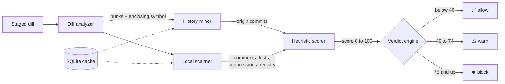
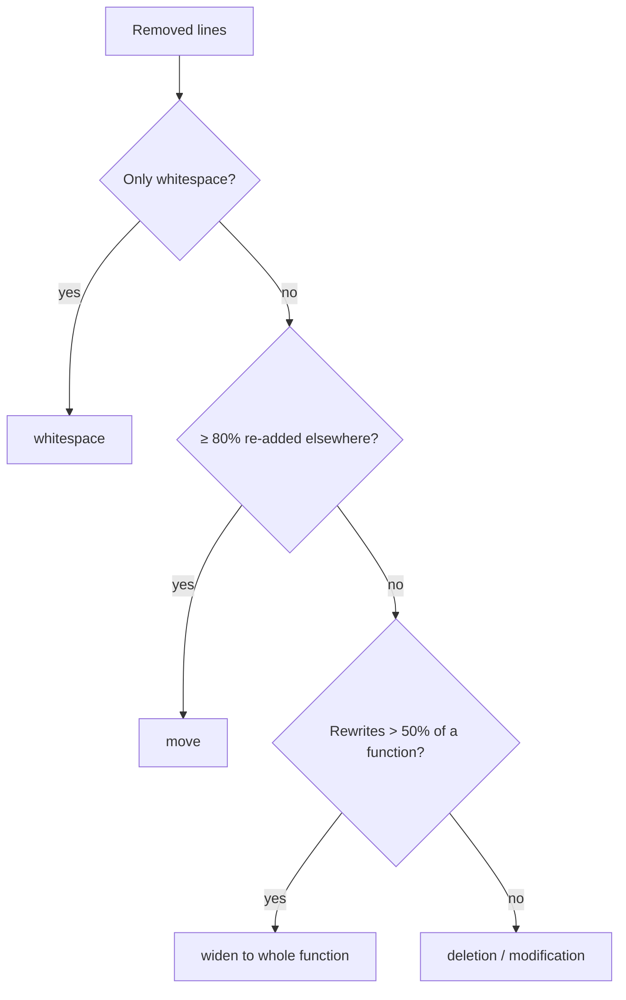
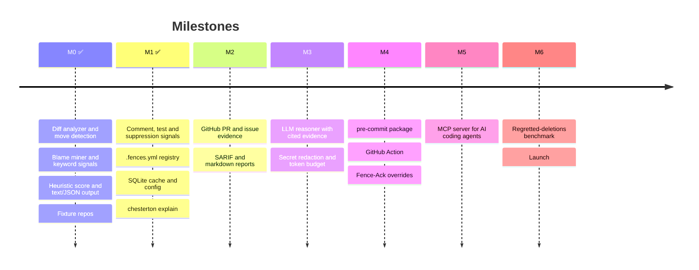

<div align="center">

# 🧱 Chesterton's Fence Agent

**Know why code exists before you delete it.**

A pre-commit check that reads your git history and tells you when a change removes code<br>
that was put there on purpose: after a bug, an outage, a security issue, or an earlier mistaken removal.


</div>

---

> *"Do not remove a fence until you know why it was put up in the first place."*
> &nbsp;&nbsp;— paraphrasing G. K. Chesterton, *The Thing* (1929)

## The problem

Every codebase has lines that look pointless and aren't:

```python
def charge(order):
    receipt = gateway.submit(order.total)
    if receipt is None:                      # ← looks redundant
        raise GatewayError("empty response") # ← "simplify" it away?
    ledger.record(receipt)
```

Why the check is there doesn't show in the code. It's recorded somewhere else: a commit titled
*"Fix duplicate charges during gateway outage (INC-412)"*, a comment three lines up, or a test that
depends on it. People who are refactoring, and AI coding agents especially, delete lines like this
because nothing nearby says why they exist.

Chesterton's Fence Agent looks that reason up for you before the commit goes through.

```console
$ git commit -m "Simplify charge()"

chesterton: 1 block, 1 warn, 0 allow

BLOCK  81.5  billing.py:21-22  charge  [deletion]
  Added for an incident or security issue: b7eec8b on 2024-01-15, "Fix duplicate charges during gateway outage (INC-412)".
  commit:b7eec8b74cad  2024-01-15  Fix duplicate charges during gateway outage (INC-412)  (incident_or_security, fix_surgical)

WARN  55  retry.py:21-22  charge  [deletion]
  Added by a small bug fix: 1c8d52a on 2024-01-15, "Fix crash when gateway returns an empty body".
  commit:1c8d52a4875c  2024-01-15  Fix crash when gateway returns an empty body  (fix_surgical)
```

Each verdict cites the commit, comment, test, or registry entry that supports it. The tool never
claims a reason it can't point to.

## Ask why any line exists

`chesterton explain` works without a change. Point it at lines, and it shows what removing them would
trigger and the full history behind them. Here it is on real code from **Express**:

```console
$ chesterton explain lib/utils.js:267-271

lib/utils.js:267-271 in parseExtendedQueryString  (at 43fca52)
  267 | function parseExtendedQueryString(str) {
  268 |   return qs.parse(str, {
  269 |     allowPrototypes: true
  270 |   });
  271 | }

If removed: BLOCK  100
  Restored after an earlier removal: 697547c on 2025-12-01, "Revert "sec: security patch for CVE-2024-51999"".
  commit:697547cde621  2025-12-01  Revert "sec: security patch for CVE-2024-51999"  (revert_of_removal, incident_or_security)
  commit:7bea53b92b52  2015-07-06  deps: qs@4.0.0  (old_many_authors)

History of these lines, newest first:
  697547c  2025-12-01  Ulises Gascon  Revert "sec: security patch for CVE-2024-51999"
  2f64f68  2025-12-01  Chris de Almeida  sec: security patch for CVE-2024-51999
  999546d  2016-05-31  Douglas Christopher Wilson  deps: qs@6.2.0
  7bea53b  2015-07-06  Douglas Christopher Wilson  deps: qs@4.0.0
```

`allowPrototypes: true` looks like the obvious thing to delete. History shows that a security patch
already removed it and the maintainers deliberately reverted that patch the same day. Anyone touching
this line should read that revert first.

## How it works



### 1. Diff analyzer: what's actually being removed?

The diff is cut into **hunks**, and each one is classified before any history is read. Moved or
reformatted code shouldn't raise an alarm.

| Kind | Example | Effect on risk |
|---|---|---|
| **deletion** | lines removed, nothing added | scored normally |
| **modification** | lines replaced with different lines | scored normally |
| **move** | ≥ 80% of the removed lines reappear elsewhere in the change, including in a new file | × 0.1 |
| **whitespace** | only spacing changed (strings and Python indentation are respected) | × 0 |
| **rename** | file renamed with no content change | not scored |

[tree-sitter](https://tree-sitter.github.io/) then maps every hunk to the **function or class** it
lives in. When more than half of a function changes, the whole function is treated as removed logic,
so a check that survived a rewrite unchanged is still examined.



### 2. Gathering evidence from history and from the code around it

**From history.** For each hunk, `git blame -w -M -C -C` runs against the **parent** revision. That
finds the commit that wrote each removed line, even if the code was later re-indented or moved
between files. The tool then reads those commits' messages, sizes and authors, and checks for reverts.

**From the code around it.** The tool also looks at comments within 3 lines of the hunk, tests that
mention the enclosing function, lint suppressions in the removed lines, and the team's fence registry.

### 3. Signals: is there a documented reason?

| Signal | Fires when… | Weight |
|---|---|:---:|
| 🧱 **Fence registry** | `.fences.yml` declares this function or file a fence | **100**, forces ⛔ |
| 🔁 **Revert of a removal** | the origin commit is a `git revert` that restored these exact lines | **80** |
| 💬 **"Do not remove" comment** | a nearby comment says *do not remove*, *needed because*, *workaround for*… | **70** |
| 🚨 **Incident or security** | the origin commit mentions an outage, `SEV2`, `INC-123`, `CVE-…`, XSS, injection… | **65** |
| 🩹 **Surgical bug fix** | the origin commit says *fix / bug / regression / workaround* and changed ≤ 10 lines | **55** |
| ⏱️ **Concurrency or compat** | the origin commit mentions a race, timeout, retry, legacy clients, IE11… | **40** |
| 🔕 **Lint suppression** | removed lines carry `# noqa`, `eslint-disable`, `@SuppressWarnings`, `//nolint`… | **35** |
| 📝 **Explanatory comment** | a nearby comment has `NOTE:`, `HACK`, `XXX`, `see #123`, or a URL | **30** |
| 🧪 **Referenced by tests** | a test file mentions the enclosing function by name | **30** |
| 🏛️ **Long-lived, many hands** | the code is over 2 years old, and 3+ people have edited these lines | **15** |

Some evidence doesn't count. A "fix typo" or "fix lint" commit isn't a reason for code to exist. Sign-off
lines are skipped so a reviewer named *Patch* can't trigger the fix keyword. Test lookups skip generic
names like `run` or `__init__`.

### 4. Scoring: combining the evidence

The strongest signal counts in full. The others add diminishing credit, and each kind of signal
counts once:

$$\text{score} = \min\Big(100,\; w_{\max} + 0.3 \times \sum w_{\text{others}}\Big) \times \text{modifiers}$$

**Worked example.** A commit called *"Fix duplicate charges during gateway outage (INC-412)"* that
changed 4 lines:

```
incident_or_security   65   ← strongest, counts fully
fix_surgical           55   × 0.3 = 16.5
                       ─────────────
score                  81.5  →  ⛔ block (≥ 75)
```

If the same code had only been **moved** to another file, the score would be 81.5 × 0.1 = 8.2,
which is ✅ allow. If it came from a repo's **initial bulk import**, it would be halved.

## Declare your own fences

Some reasons never made it into a commit message. Write them down in `.fences.yml`:

```yaml
- path: src/billing/retry.py
  symbol: charge_with_retry
  reason: "Stripe double-charge incident 2023-08, see INC-412"
  level: block        # or warn

- path: src/compat/**  # globs work; leave out symbol to fence the whole file
  reason: "Older Android clients still call these endpoints"
  level: warn
```

- **What counts as a match:** any removal that overlaps the fenced function, even one that deletes its neighbor in the same hunk.
- **Which version is read:** the registry is read from the **parent commit**, so deleting an entry and its code in the same commit still trips the fence.
- **Moving fenced code:** it is still allowed, with the registry entry listed as evidence.

## Configure it

Put a `.chesterton.toml` at the repository root. Every key is optional:

```toml
mode = "standard"          # advisory | standard | strict
fail_closed = false        # exit 3 instead of 0 when the tool itself fails
max_hunk_lines = 500

[thresholds]
warn = 40
block = 75

[paths]
ignore = ["legacy/**", "*.generated.ts"]   # added to the built-in list
use_default_ignore = true

[keywords]                 # regexes added to the built-in keyword classes
incident = ["INC-\\d+", "pager"]
security = ["pentest"]

[weights]                  # override any signal's weight
fix_surgical = 45
tested = 20

[cache]
enabled = true
```

Typos in the config are reported, not ignored. In a hook, a broken config fails open unless
`fail_closed = true`.

## Tried on real repositories

The tool replayed the last ~150 commits of two popular open-source projects:

| Repository | Commits | Errors | p95 cold | p95 cached | Blocks |
|---|:---:|:---:|:---:|:---:|:---:|
| pallets/flask | 132 | 0 | 0.58 s | 0.30 s | 1 |
| expressjs/express | 147 | 0 | 0.35 s | 0.21 s | 3 |

Known noise, which later milestones address:
- Dependency bumps that replace one CVE-fix version with a newer one look like removing a security fix. The LLM step (M3) is meant to judge whether the replacement keeps the fix.
- Squash-merged commits with long bullet lists can pass one bullet's keyword on to every line they touched.

## Install

```sh
git clone https://github.com/yajushivudatha/fence-agent.git
cd fence-agent
python3 -m venv .venv
.venv/bin/pip install -e '.[dev]'
```

All grammars ship pre-compiled, so the tool never contacts the network.

## Usage

```sh
chesterton check                       # staged changes vs HEAD (the default)
chesterton check --base main           # this branch vs its merge base with main
chesterton check --range A..B          # a commit range (A...B uses the merge base)
chesterton check --format json         # machine-readable report
chesterton check --mode strict         # fail on warnings too

chesterton explain src/app.py:42       # why does this line exist?
chesterton explain src/app.py:42-60    # ...or this block?

chesterton cache prune                 # drop cache entries unused for 30 days
chesterton cache prune --days 0        # clear the cache
```

### Modes and exit codes

| Mode | Fails the commit on | | Exit code | Meaning |
|---|---|---|:---:|---|
| `advisory` | nothing | | `0` | nothing blocks the change |
| `standard` | ⛔ block | | `1` | at least one block |
| `strict` | ⛔ block or ⚠️ warn | | `2` | a warning, in strict mode |
| | | | `3` | tool error, only when failing closed |

By default, tool errors exit `0`, so a broken tool never stops anyone from committing.

### Use it as a git hook today

```sh
printf '#!/bin/sh\nexec .venv/bin/chesterton check --staged\n' > .git/hooks/pre-commit
chmod +x .git/hooks/pre-commit
```

### The cache

Results are cached in `.git/chesterton/cache.db`, so running the check again on the same change takes
a fraction of the time. Commits are cached by SHA. Blame results are cached by base commit, path, and
line range rather than by file content, because a revert can bring back an old file whose lines now
belong to the revert. A damaged cache is skipped, never fatal.

### What's skipped

Generated code, vendored code, `node_modules`, migrations, lockfiles, minified bundles, protobuf
output, and prose (`*.md`, `*.rst`, `docs/`). Hunks over 500 lines are skipped too, and the report
says so.

## Supported languages

Symbol mapping covers **Python, JavaScript, TypeScript/TSX, Go, Java, Rust, C, and C++**, including
JavaScript's `obj.method = function name() {}` style. Other files still get line-level analysis from
history, comments, and suppressions. They just don't get function names, test lookups, or rewrite
detection.

## Roadmap



The planned **MCP server** lets AI coding agents call `check_removal` before they delete code, and
stop to ask a human whenever the verdict is ⛔ block.

## Project layout

```
chesterton/
├── cli.py               check, explain, cache prune
├── config.py            .chesterton.toml loading and validation
├── cache.py             SQLite cache in the git directory
├── pipeline.py          diff → evidence → score → findings
├── diff/
│   ├── analyzer.py      parse git diff, classify hunks, widen rewrites
│   ├── moves.py         detect relocated code
│   └── symbols.py       tree-sitter symbol mapping
├── history/
│   ├── blame.py         origin commits per line range
│   ├── log.py           commit metadata, reverts, authors, line history
│   └── signals.py       keyword classes, refs, revert markers
├── local/
│   ├── comments.py      "do not remove" and explanatory comments
│   ├── tests.py         tests that reference the symbol
│   ├── suppressions.py  lint and type-checker suppressions
│   └── registry.py      .fences.yml
├── scoring/             weights and the heuristic score
├── verdict/engine.py    thresholds, registry floors, modes, exit codes
└── report/text.py       terminal output
tests/
├── fixtures/repos/make_repo.py   scripted repos with known fences
├── golden/                       expected report output
├── test_scenarios.py             end-to-end checks
├── test_m1.py                    config, cache, local signals, registry, explain
└── test_units.py                 parsing, classification, scoring
```

## Development

```sh
.venv/bin/pytest                                        # 144 tests
UPDATE_GOLDEN=1 .venv/bin/pytest -k golden              # refresh the golden report
.venv/bin/python tests/fixtures/repos/make_repo.py /tmp/fences   # build the scenarios to try by hand
```

Each fixture repo is built from fixed authors and dates, so commit SHAs and reports are the same on
every machine. The 26 scenarios include:
- surgical fixes, incidents, reverts, and rewrites
- moves within a file and into new files
- whitespace-only changes, and Python dedents that change behavior
- renames, bulk imports, and long-lived code
- keep-comments, suppressions, and tested symbols
- registry fences that are blocked, warned, deleted alongside their code, overlapped, or moved

<div align="center">
<br>
<sub>Built for anyone, human or agent, who has ever deleted a line and then spent a week finding out why it was there.</sub>
</div>
